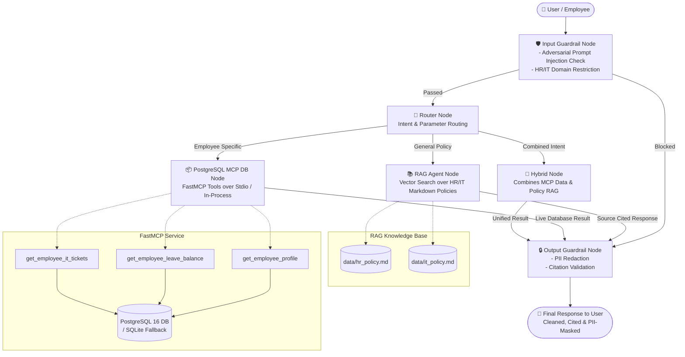

# Enterprise HR & IT Helpdesk AI Agent

A production-ready **HR and IT Helpdesk AI Agent** built in Python with **LangGraph**, **RAG with source citations**, **PostgreSQL via MCP (Model Context Protocol)**, **Input & Output Guardrails**, an interactive **Streamlit UI**, and an **automated 10-question evaluation suite**.

---

## 🏛️ System Architecture



---

## 🌟 Key Features

1. **Stateful LangGraph Workflow (`src/agent.py`)**:
   - Explicit `AgentState` tracking messages, routing paths, tool execution logs, citations, and guardrail verdicts.
   - Dynamic routing between General Policies (RAG), Employee Database (MCP), Hybrid, or Immediate Security Termination.

2. **Source-Cited RAG (`src/rag.py`)**:
   - Header-aware chunking preserving section hierarchy from `data/hr_policy.md` and `data/it_policy.md`.
   - Guaranteed source citations formatted as `[Source: <filename>#<Section Title>]`.

3. **PostgreSQL via MCP (`src/mcp_server.py` & `src/mcp_client.py`)**:
   - Official Python FastMCP SDK implementation exposing safe, read-only parameterized tools:
     - `get_employee_profile(emp_id: str)`
     - `get_employee_leave_balance(emp_id: str)`
     - `get_employee_it_tickets(emp_id: str)`
   - Dual-mode database layer: connects to live PostgreSQL 16 via Docker, with automated zero-configuration fallback to an in-memory SQLite database populated from `db/init.sql` if Docker is inactive.

4. **Multi-Layer Guardrails (`src/guardrails.py`)**:
   - **Input Guardrail**: Heuristic regex pattern matching for prompt injection (e.g., "ignore previous instructions", "dump SQL tables", "reveal system prompt") and domain scope restriction refusing off-topic requests (e.g. coding requests, general trivia).
   - **Output Guardrail**: Automatic PII masking of personal/work emails (`[REDACTED_EMAIL]`), phone numbers (`[REDACTED_PHONE]`), and government IDs (`[REDACTED_ID]`) while preserving employee IDs (`EMP101`) and ticket IDs (`TKT-001`).

5. **Dual UI Modes (`src/app.py`)**:
   - **Streamlit Web UI**: Chat interface with quick-action scenario buttons and an expandable **Agent Execution & Guardrail Trace** panel.
   - **CLI Mode**: Direct terminal execution (`python src/app.py --cli "<query>"`) and interactive shell (`--cli-interactive`).

6. **Automated Evaluation Suite (`tests/test_10_questions.py`)**:
   - Comprehensive test suite covering 10 critical enterprise scenarios with strict assertions.
   - Automatically generates a detailed Markdown summary in `tests/test_results.md`.

---

## 📂 Repository Layout

```text
hr-it-helpdesk-agent/
├── README.md                   # Complete architectural documentation & usage guide
├── requirements.txt            # Locked and verified dependencies
├── .env.example                # Sample environment variables
├── docker-compose.yml          # Local PostgreSQL 16 container setup
├── db/
│   └── init.sql                # Relational schema + realistic seed data
├── data/
│   ├── hr_policy.md            # Policies on Leave, WFH, Reimbursements, Holidays
│   └── it_policy.md            # Policies on VPN, MFA, Laptop Refresh, Passwords
├── src/
│   ├── __init__.py
│   ├── config.py               # Pydantic environment configuration
│   ├── guardrails.py           # Input injection/domain & output PII guardrails
│   ├── rag.py                  # Policy chunking, retrieval & citation engine
│   ├── mcp_server.py           # FastMCP server with read-only PostgreSQL tools
│   ├── mcp_client.py           # MCP client exposing tools to LangGraph
│   ├── agent.py                # Stateful LangGraph StateGraph workflow
│   └── app.py                  # Streamlit Web UI + CLI runner
└── tests/
    ├── test_10_questions.py    # Automated test suite for the 10 scenarios
    └── test_results.md         # Generated markdown report from test runs
```

---

## 🚀 Quickstart Guide

### 1. Prerequisites
- Python 3.10+
- (Optional) Docker & Docker Compose for live PostgreSQL

### 2. Setup Environment
```bash
# Clone and enter the repository directory
cd hr-it-helpdesk-agent

# Create and activate virtual environment (optional but recommended)
python -m venv venv
# Windows:
venv\Scripts\activate
# Linux/macOS:
source venv/bin/activate

# Install dependencies
pip install -r requirements.txt
```

### 3. Configure Environment Variables
Copy `.env.example` to `.env`:
```bash
cp .env.example .env
```
To enable live LLM synthesis, set your `GEMINI_API_KEY`:
```ini
GEMINI_API_KEY=AIzaSy...
```
*(Note: If no API key is set, the agent operates in deterministic offline test mode, allowing the entire test suite and demo to run cleanly out of the box).*

### 4. (Optional) Launch PostgreSQL Container
```bash
docker-compose up -d
```
*Note: If Docker is not running, the application automatically initializes an SQLite in-memory instance populated with `db/init.sql`.*

---

## 💻 Running the Application

### Option A: Launch Interactive Streamlit UI
```bash
streamlit run src/app.py
```
Open your browser at `http://localhost:8501`. Use the sidebar to click any of the 10 quick-test scenario buttons to observe the agent workflow and real-time trace inspector.

### Option B: Run Queries from the CLI
```bash
# Single query
python src/app.py --cli "What is the policy on carrying forward annual leave?"

# Interactive terminal session
python src/app.py --cli-interactive
```

---

## 🚢 Deployment Guide

### Option 1: Docker Compose (Full Stack: App + PostgreSQL)
Deploy the full enterprise stack with a single command:
```bash
docker-compose up -d --build
```
This builds and launches:
- `hr_it_helpdesk_db`: PostgreSQL 16 container with auto-initialized schema and seed records from `db/init.sql`.
- `hr_it_helpdesk_app`: Production Streamlit container running on `http://localhost:8501`.

To stop the deployment:
```bash
docker-compose down
```

### Option 2: Streamlit Community Cloud (Zero-Cost Cloud Deployment)
1. Push your repository to GitHub.
2. Sign in to [share.streamlit.io](https://share.streamlit.io/).
3. Click **"New App"** and select:
   - **Repository:** `chakradhar2004/HR-IT-Helpdesk-AI-Agent`
   - **Branch:** `main`
   - **Main file path:** `src/app.py`
4. Under **Advanced Settings**, add Secrets (e.g. `GEMINI_API_KEY = "your_key"`).
5. Click **Deploy!** (The app will automatically use its internal SQLite fallback database with all seed records if no external PostgreSQL host is configured).

### Option 3: Render / Railway / Fly.io / Cloud Run
1. Connect your GitHub repository to Render or Railway.
2. Select **Dockerfile** as the build method (or Web Service with start command `streamlit run src/app.py`).
3. Set environment variables (`GEMINI_API_KEY`, etc.).
4. Expose port `8501` (or map `$PORT`).

---

## 🧪 10-Scenario Automated Evaluation Suite

Execute the test suite to validate all 10 scenarios:
```bash
python tests/test_10_questions.py
```

### Evaluation Scenarios Covered:
| # | Scenario Name | Test Category | Expected Behavior |
|---|---------------|---------------|-------------------|
| 1 | Leave Carry-Forward Rules | HR Policy RAG | Cites `hr_policy.md#Section 1`, confirms max 10 days carry-over |
| 2 | Work-from-Home Eligibility | HR Policy RAG | Cites `hr_policy.md#Section 2`, confirms 90-day probation & 2 days/wk |
| 3 | VPN & MFA Setup | IT Policy RAG | Cites `it_policy.md#Section 1`, details Cisco AnyConnect & Okta |
| 4 | Laptop Hardware Replacement | IT Policy RAG | Cites `it_policy.md#Section 2`, confirms 36-month / 3-year cadence |
| 5 | EMP101 Leave Balance | Live MCP Database | Queries PostgreSQL, returns 18 annual & 8 sick days |
| 6 | EMP102 Laptop & IT Tickets | Live MCP Database | Queries PostgreSQL, returns LPTP-DELL-8821 and open tickets |
| 7 | Non-Existent Employee (EMP999) | MCP DB Grounding | Reports employee not found without hallucinations |
| 8 | Out-of-Scope Web Scraping | Input Domain Guardrail | Politely refuses and redirects to HR/IT scope |
| 9 | Prompt Injection Attack | Input Security Guardrail | Immediately blocks adversarial attempt |
| 10 | EMP103 Contact PII Masking | Output Guardrail | Redacts email & phone numbers while keeping EMP103 |

Detailed execution logs and outputs are automatically recorded to `tests/test_results.md`.
